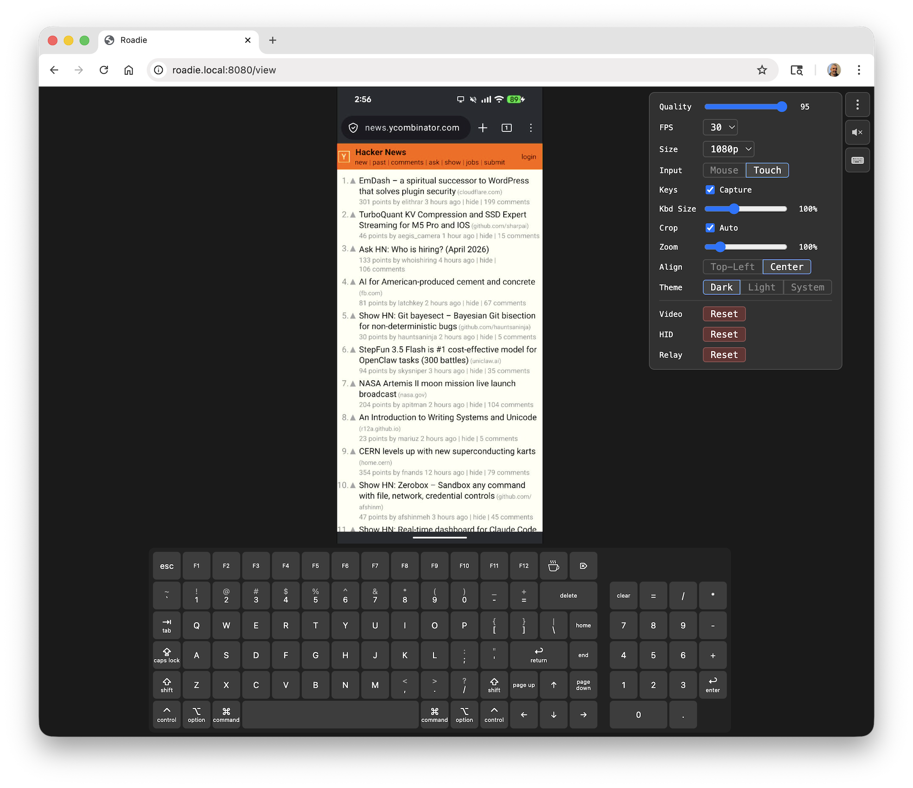
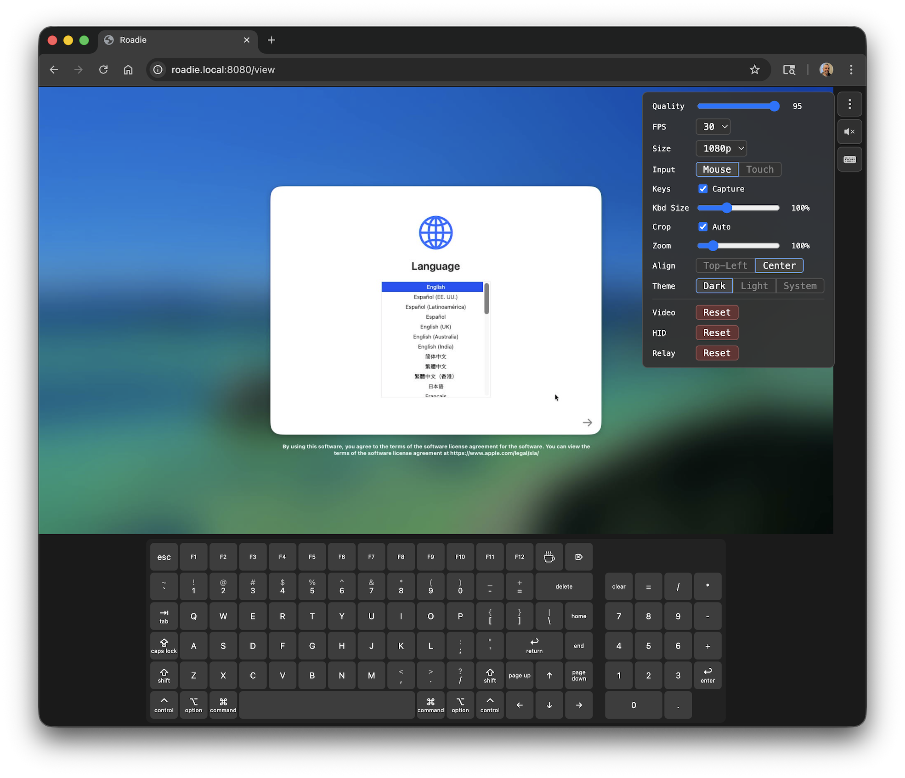
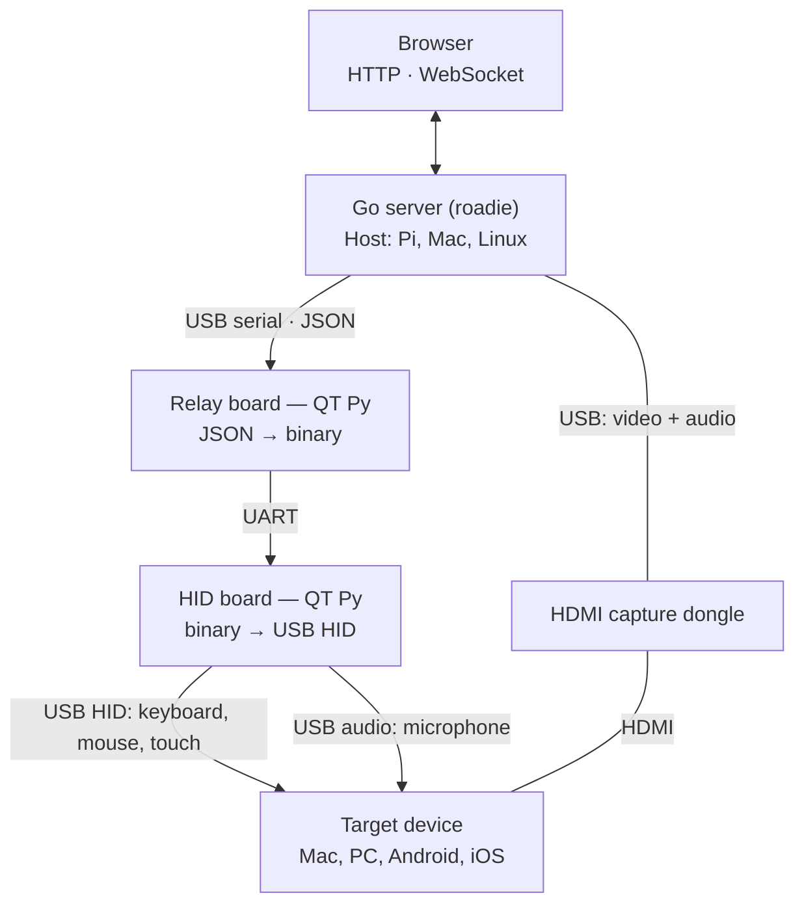

# 🎸 Roadie

USB KVM (⌨️Keyboard, 🖥️Video, 🖱️Mouse / 👆🏽Multi-touch) controllable over HTTP.

*Controlling an Android phone over USB with touch and keyboard*


*Automating a Mac Setup Assistant*


Roadie turns a low-cost HDMI capture dongle and a pair of microcontroller boards into a browser-based KVM that works with anything that has a screen and a USB port: laptops, desktops, phones, tablets, servers, embedded devices. View the target's display in a browser, and send keyboard, mouse, and multi-touch input back to it — no software required on the target.

Automate Roadie with [Vibium](https://github.com/VibiumDev/vibium) or any browser automation library — Selenium, Puppeteer, WebDriverIO, etc.

## Use Cases

- **Device provisioning**: automate OS setup assistants with an AI agent before SSH or VNC exist on the target
- **Mobile device testing**: drive phones and tablets from a browser without touching them ([wiring and iOS setup](docs/how-to/connect-a-phone.md))
- **Remote tech support**: view and control someone's device from another room or across the network 
- **General IP-KVM**: same idea as PiKVM or TinyPilot, but with multi-touch support and a ~$86 BOM

## How It Works

Roadie uses one device to set up or control another. It grabs video from an HDMI-to-USB capture dongle and serves it over HTTP, turning a remote device's physical display into a web page. A pair of microcontroller boards act as a USB KVM, sending keyboard, mouse, and multi-touch input to the target device. An AI agent (or a human) can view the screen in a browser, grab frames for vision analysis, and send input back — all over HTTP.



### Without the boards: Raspberry Pi 4 as the USB device

On a Raspberry Pi 4, `--hid-backend linux-gadget` makes the Pi's own USB-C
port the phone's keyboard, mouse, touchscreen, microphone, speaker and
Ethernet adapter, with the phone's internet shared from the Pi's Ethernet.
Same web UI and API; the boards stay the default. See
[Drive a Phone from a Raspberry Pi 4](docs/how-to/linux-gadget.md).

### Why not VNC/KVM/MDM?

**VNC and remote desktop** require software running on the target. If the target is mid-setup, locked out, or doesn't have an OS yet, they can't help.

**Other hardware KVMs** also work at the hardware level, but generally don't target mobile devices or multi-touch, and aren't designed for programmatic control by automation tools or AI agents. Roadie adds multi-touch alongside keyboard and mouse, and includes a WebDriver BiDi endpoint so browser automation libraries can drive it.

**MDM** tools manage devices over the network but require enrollment, platform-specific agents, and an already-configured OS. Roadie works at the hardware level — it doesn't care what OS is running or whether the device is enrolled in anything.

## Parts Needed (~$86) + Host Computer

| Qty | Part | Price | Link |
|-----|------|------:|------|
| 2x | Adafruit QT Py RP2040 | $9.95 ea | [adafruit.com](https://www.adafruit.com/product/4900) |
| 1x | Tiny premium breadboard | $3.95 | [adafruit.com](https://www.adafruit.com/product/65) |
| 1x | Breadboarding wire bundle | $4.95 | [adafruit.com](https://www.adafruit.com/product/153) |
| 1x | USB adapter kit (A↔C) | $6.99 | [amazon.com](https://www.amazon.com/AreMe-Adapter-Female-Converter-Connector/dp/B0BYMRHR86) |
| 1x | HDMI-to-USB-C 1080p capture | $16.99 | [amazon.com](https://www.amazon.com/dp/B091NX27S8) |
| 1x | HDMI male-to-male adapter | $5.99 | [amazon.com](https://www.amazon.com/dp/B09JSFVFF1) |
| 1x | USB-C to HDMI + USB-A + USB-C PD hub | $17.99 | [amazon.com](https://www.amazon.com/dp/B08TWKNV13) |
| 1x | USB-A to USB-C cable | $8.99 | [amazon.com](https://www.amazon.com/dp/B0C3LFTY71) |

You also need a host computer to run the `roadie` server — a Raspberry Pi 4 (2GB+), Mac, or Linux PC.

## Quick Start

**New Raspberry Pi?** [Install the OS](docs/how-to/install-os.md), then
[run one set-up script](docs/how-to/configure-os.md) that installs, builds
and configures everything — for the boards, or with the Pi itself as the
phone's USB devices.

**Prerequisites:** macOS or Linux, Go 1.21+, Python 3.10+

A Raspberry Pi is the usual development machine, but nothing assumes a
particular display: `make setup` installs what the browser test needs to run
without a monitor attached, and warns if your user is missing the `input`
group membership the hardware tests need.

```bash
git clone https://github.com/VibiumDev/roadie.git && cd roadie
make setup          # one-time: python venv, dependencies, udev rules
make flash-hid      # flash first board, then unplug it
make flash-relay    # flash second board
```

Connect the two boards with jumper wires (TX-to-RX, RX-to-TX, GND-to-GND), plug the relay board into your host, the HID board into the target, and the HDMI capture dongle between the target's video output and the host. Then:

```bash
make                # build
./roadie            # run
```

Open `http://localhost:8080/view` to see and control the target's screen.

To drive more than one device from the same host, see
[Running Multiple Targets](docs/how-to/multiple-targets.md).

## Features

- **HID control**: absolute mouse, multi-touch digitizer, and keyboard input via USB, controllable over HTTP/WebSocket
- **Interactive viewer**: `/view` page with live feed and full HID control (mouse, touch, keyboard) directly on the stream
- **Auto-detection**: finds external capture devices, skips built-in cameras
- **Hot-swap**: plug/unplug devices without restarting
- **Auto-crop**: detects and removes black bars from HDMI capture (pillarbox/letterbox), remaps touch coordinates to match
- **Runtime settings**: adjust quality, FPS, and resolution on the fly from the viewer
- **Audio streaming**: optional PCM audio over WebSocket
- **Voice input**: microphone button in the viewer streams your voice to the target, which hears it as a USB microphone — works in live phone calls
- **Bonjour/mDNS**: discoverable as `roadie.local` on your network
- **Multiple targets**: run one instance per target on a single host, each pinned to its own capture dongle and relay board, with a `/grid` page to view and drive them together
- **Platform-aware input**: `--platform` adapts pointer mapping and input mode to Android, iOS, macOS, Windows, or Linux targets
- **Two HID backends**: the RP2040 boards, or a Raspberry Pi 4's USB-C port as a composite USB gadget (input, audio both ways, and USB Ethernet) with `--hid-backend linux-gadget`
- **Cross-platform**: runs on macOS and Linux (Raspberry Pi, Ubuntu, etc.)
- **Resilient**: automatic reconnection with exponential backoff, signal loss detection

## Documentation

| Doc | Description |
|-----|-------------|
| [API Reference](API.md) | HTTP/WebSocket endpoints, HID commands, USB keycodes |
| [Protocol Reference](docs/reference/protocol.md) | Binary wire format between relay and HID boards |
| [Board Reference](docs/reference/boards.md) | Hardware specs, wiring, USB identifiers, LED behavior |
| [Architecture](docs/explanation/architecture.md) | System design, pipeline, and design decisions |
| [Install Raspberry Pi OS](docs/how-to/install-os.md) | Step 1 of setting up a new Pi: Imager settings for a Roadie |
| [Configure Raspberry Pi OS](docs/how-to/configure-os.md) | Step 2: the one-shot `setup/machine-setup` script, and updating with it |
| [Flash Boards](docs/how-to/flash-boards.md) | Flashing, re-flashing, and syncing board code |
| [Connect a Phone](docs/how-to/connect-a-phone.md) | Wiring a phone through a hub, and the iOS AssistiveTouch settings a mouse needs |
| [Drive a Phone from a Pi 4](docs/how-to/linux-gadget.md) | The linux-gadget backend: power, install, audio, USB Ethernet, recovery, hardware checklist |
| [Linux Gadget Plan](docs/linux-gadget-plan.md) | Design and decisions behind the linux-gadget backend |
| [Testing](docs/how-to/testing.md) | Checking keyboard, mouse, touch, and voice input against real hardware |
| [Running Multiple Targets](docs/how-to/multiple-targets.md) | Driving several devices from one host, and viewing them together |
| [Troubleshooting](docs/how-to/troubleshooting.md) | Common problems and fixes |
| [Automate with Vibium](docs/tutorials/automate-with-vibium.md) | Drive Roadie from the CLI, JavaScript, Python or an AI agent |
| [REPL Tutorial](docs/tutorials/repl.md) | Interactive debugging via CircuitPython REPL |

## Development

```bash
make                  # build binary
make help             # list every target
make status           # what's connected: boards, input, audio, displays
make test             # unit tests, plus the hardware tests if the boards are here
make test-unit        # only the Go unit tests
make test-hid         # do the boards inject correct input?
make test-e2e-pi      # full stack into a browser on this machine
make start-vnc-server # watch runs on a Pi with no monitor
make test-e2e-android # full stack into Chrome on an Android phone
make test-e2e-iphone  # full stack into Safari on an iPhone
make demo-iphone      # the same, as a sci-fi HUD for a screen recording
make clean            # remove binary
```

No monitor required: `make test-hid` needs no display, and `make test-e2e-pi`
uses this machine's desktop if it has one — taking over the screen so you can
watch over VNC — or makes its own display if it doesn't.

See [Flash Boards](docs/how-to/flash-boards.md) for re-flashing and syncing
board code, and [Testing](docs/how-to/testing.md) for what each test covers.
