# MJPEG vs WebRTC

Roadie puts a phone's screen in your web browser and lets you tap and type on
it from there. It runs on a small computer beside the phone, the rig: a
Raspberry Pi 4 here. It can send that picture two ways. MJPEG sends every
frame as a complete photograph. WebRTC sends H.264 video, which describes only
what changed since the last frame. For a phone screen that mostly sits still,
the difference is a factor of ten to fifty in bandwidth, and a quarter of the
rig's work.

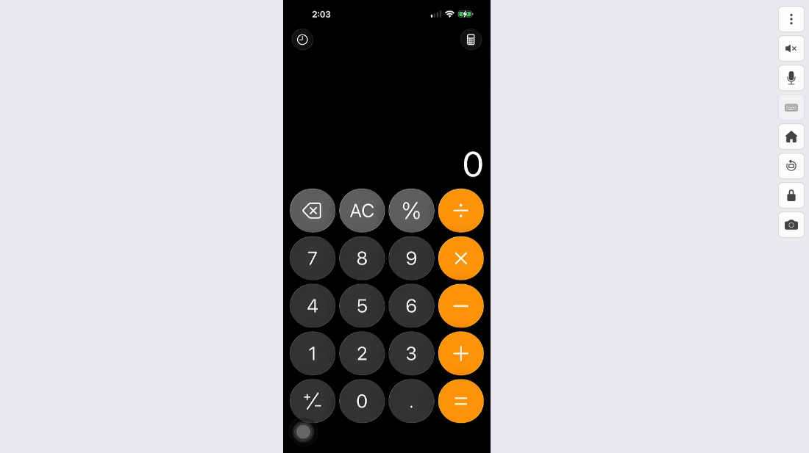

*Roadie's viewer page in a browser, showing the iPhone over WebRTC. The toolbar
has the menu, mute, microphone, keyboard, Home, Recents, Lock and Screenshot
buttons. Everything measured here went through this picture or its Screenshot
button.*

## Two things to take away

1. **If an agent is driving, the stream hardly matters.** An agent does not
   watch video. It asks for a screenshot when it needs one, and since each one
   is a JPEG of 20 to 60 KB the agent's cost is per screenshot rather than per
   hour, while the rig encodes no video at all as long as nobody is watching.
2. **If a person is watching, use WebRTC.** For the same picture it moves a
   tenth to a fiftieth of the data MJPEG does and costs the rig a quarter of
   the work. MJPEG stays as the fallback for a browser or a network where
   WebRTC cannot connect.

## How fast a monthly data cap goes

Where a home connection has a cap it is 1 to 1.5 TB a month; 1.2 TB is the
yardstick here.

| Watched around the clock | Uses up 1.2 TB in |
|---|---:|
| MJPEG at the sharpest setting (1080p, 30 fps, quality 94) | 7 days |
| MJPEG at the default (quality 80) | 12 days |
| WebRTC at a typical 0.5 Mbps | about 7 months |
| WebRTC if it ran at the 1.5 Mbps cap the whole time | about 2.5 months |

At 8 hours a day the sharpest MJPEG setting lasts 22 days and the
default 37; a working month over WebRTC uses 3% of the cap.

**Only if a person is watching.** An agent driving the phone does not watch;
it takes screenshots, and a very busy month of those is 27 GB, 2% of the cap.
The exception is recording: when Vibium drives the phone with recording on,
its Firefox sits on the viewer page and the stream flows to it for the whole
session, with nobody watching. The WebM file is written wherever that Firefox
runs, a cloud box or a laptop, but the stream still crosses the network to get
there.

Behind those figures, MJPEG at 1080p, 30 frames a second and JPEG quality 94
is 15.4 Mbps, which is 6.9 GB an hour, while WebRTC on the same picture is
0.3 Mbps when the screen sits still and up to its cap when things move, which
is 0.1 to 0.7 GB an hour. Both were measured on Oct 27, 2026 on a Roadie
server, a Raspberry Pi 4 with an iPhone 15 Pro Max attached in portrait.
Landscape figures are scaled from those measurements by pixel count;
everything else is measured. The method is at the end.

Xfinity's cap is 1.2 TB on older plans, though it was dropped from plans sold
since June 2025 and never applied in the Northeast; Cox keeps 1.25 TB on every
wired plan, and AT&T's older copper and DSL tiers have 1 to 1.5 TB while its
fiber has none. Most fiber providers have no cap, and overage runs about $10
per 50 GB where one applies. The stream counts on whichever end has a cap:
the rig's connection uploads it, the viewer's downloads it.

## How the picture gets to you

iPhone 15 Pro Max → HDMI → capture device → USB → Raspberry Pi 4 running
Roadie → network → your browser.

The phone's screen leaves it as an HDMI signal, the same kind a TV takes,
through a USB-C hub. A small HDMI-to-USB capture device, the kind sold for
recording game consoles, turns that signal into a stream of plain 1920×1080
pictures at 30 a second and hands them to the rig, the Raspberry Pi 4 that
runs Roadie. Roadie first crops away the black bars around the phone's
picture, so what travels is the phone's screen and nothing else. From there,
the picture has two roads to the browser:

- **MJPEG**, Motion JPEG. The rig compresses each picture into a JPEG, like a
  photo from a camera, and sends them one after another over an ordinary web
  connection. The browser shows each one as it arrives. MJPEG is simple, works
  everywhere and starts every frame from scratch.
- **WebRTC**, carrying H.264. The Pi 4's built-in video encoder, the same kind
  of hardware that compresses video in a phone camera, turns the pictures into
  an H.264 video stream. Every two seconds it sends a complete picture, a
  keyframe; between those it sends only the differences. WebRTC is the
  browser's channel for live video, the one video calls use. On a flaky
  network it drops late frames instead of queueing them, so the picture stays
  current.

Bandwidth here is in megabits per second (Mbps). A stream at 1 Mbps moves
450 MB in an hour.

## Who uses it, and what a month costs

Four kinds of use, with the hours and data each adds up to in a month, and
what share of a 1.2 TB cap that is. The month columns count the stream while
a person watches plus the agent's screenshots.

| Who | Hours watched | Screenshots | Month over WebRTC | Month over MJPEG |
|---|---:|---:|---:|---:|
| **Agents running around the clock.** Tasks run by agents day and night, like a test suite; a person looks in for about 10 hours a month. Screenshots: one every 3 s, tasks running 80% of the time. Screenshot data: 26 GB. | 10 h | 691,200 | 28 GB (2% of the cap) | 67 GB (6% of the cap) |
| **The same, with recording on.** Vibium driving with recording on: its Firefox sits on the viewer page the whole month, so the stream never stops. Screenshot data: 26 GB. | 720 h | 691,200 | 285 GB (24% of the cap) | 3.0 TB (2.5 times the cap of the cap) |
| **A developer with Claude Code or Codex.** Business hours, the viewer open all day while the agent works. Screenshots: one every 5 s, about half the day. Screenshot data: 2.4 GB. | 176 h | 63,360 | 42 GB (3% of the cap) | 718 GB (60% of the cap) |
| **A vibe-coding platform checking its work.** Lovable, Replit and the like: ten checks a day, three minutes of watching each, 30 screenshots per check. Screenshot data: 248 MB. | 11 h | 6,600 | 2.7 GB (under 1% of the cap) | 45 GB (4% of the cap) |
| **Someone spot-checking by hand.** Ten minutes a day, no agent. | 5 h | 0 | 900 MB (under 1% of the cap) | 20 GB (2% of the cap) |

The table assumes that watching over WebRTC averages 0.5 Mbps, between a
still screen and light activity, and 0.8 Mbps with an agent tapping away the
whole time. MJPEG is at Roadie's defaults: 1080p, 30 frames a second, quality
80. A screenshot at quality 80 is 39 KB. A month is 30 days, a working month
22 days of 8 hours. While nobody is watching, the rig captures but encodes
nothing; a screenshot costs it a few milliseconds of work.

## An hour, a week, a month

Common settings, portrait at 1080p. The WebRTC rows are the measured still
screen and two bitrate caps; a real session lands between the still figure
and its cap. A month is 30 days.

| Setting | 1 hour | 5 hours | Week, 4 h a day | Week, 8 h a day | Week, 24/7 | Month, 4 h a day | Month, 8 h a day | Month, 24/7 |
|---|---:|---:|---:|---:|---:|---:|---:|---:|
| MJPEG 720p, 10 fps, quality 62 | 572 MB | 2.9 GB | 16 GB | 32 GB | 96 GB | 69 GB | 137 GB | 412 GB |
| MJPEG 1080p, 10 fps, quality 80 | 1.4 GB | 6.8 GB | 38 GB | 76 GB | 228 GB | 163 GB | 325 GB | 976 GB |
| MJPEG 1080p, 30 fps, quality 80 | 4.1 GB | 20 GB | 114 GB | 228 GB | 683 GB | 488 GB | 976 GB | 2.9 TB |
| MJPEG 1080p, 30 fps, quality 94 | 6.9 GB | 35 GB | 194 GB | 388 GB | 1.2 TB | 831 GB | 1.7 TB | 5.0 TB |
| WebRTC, still screen (measured) | 135 MB | 675 MB | 3.8 GB | 7.6 GB | 23 GB | 16 GB | 32 GB | 97 GB |
| WebRTC at a 1.5 Mbps cap | 675 MB | 3.4 GB | 19 GB | 38 GB | 113 GB | 81 GB | 162 GB | 486 GB |
| WebRTC at the 4 Mbps maximum | 1.8 GB | 9.0 GB | 50 GB | 101 GB | 302 GB | 216 GB | 432 GB | 1.3 TB |

Left running around the clock for a month, MJPEG at the sharpest setting
moves 5.0 TB. WebRTC on a still screen moves 97 GB in the same
month, and at most 1.3 TB at the 4 Mbps maximum. Eight hours a day, closer
to a working session, is a third of each.

## Audio, and screenshots at a steady pace

Two more things can run around the clock. Audio today travels as raw PCM over
a WebSocket, 48 kHz stereo 32-bit samples at 3.1 Mbps, which is more than the
video over WebRTC: a month of it alone almost fills a 1.2 TB cap. The next
milestone moves audio onto the WebRTC connection as G.722 or PCMU, which is
64 kbps of sound and about 80 kbps on the wire with packet headers, a
fortieth of today. The microphone the other way, from the viewer to the
phone, is 256 kbps today while someone talks and will share the WebRTC
connection at 64 kbps as well.

An agent that takes a screenshot on a timer, rather than when it needs one,
spends by the pace it picks:

| Around the clock | An hour | A day | A month | Of a 1.2 TB cap |
|---|---:|---:|---:|---:|
| Audio as today: raw PCM over a WebSocket, 48 kHz stereo 32-bit | 1.4 GB | 33 GB | 995 GB | 83% |
| Audio over WebRTC, G.722 or PCMU at 64 kbps (the next milestone) | 36 MB | 864 MB | 26 GB | 2% |
| A screenshot every second, quality 80 | 136 MB | 3.3 GB | 98 GB | 8% |
| A screenshot every 5 seconds | 27 MB | 650 MB | 20 GB | 2% |
| A screenshot every 30 seconds | 4.5 MB | 108 MB | 3.3 GB | under 1% |
| A screenshot every 5 minutes | 452 KB | 11 MB | 325 MB | under 1% |

## What an agent sees

An agent such as Claude Code, Codex or a platform's own model does not watch
the stream. It drives the phone through Roadie's API, sending taps and
keystrokes, and asks for a screenshot when it wants to see the result. Each
screenshot is one JPEG, at the quality the agent asks for, of the phone's
picture and nothing else. That is the same path a person's Screenshot button
uses.

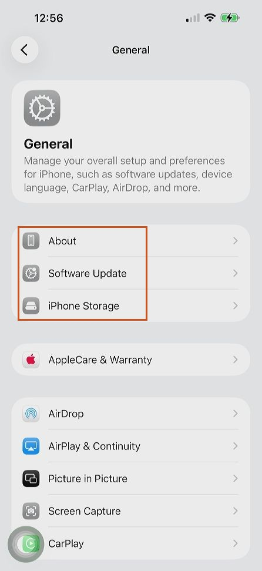

The full screenshot at quality 80, 39 KB. The outlined region is shown below
at twice its size, straight from the rig at each quality, with each file's
size. The iPhone 15 Pro Max's screen is 1290×2796 pixels; over HDMI it arrives
as a 446×972 picture, so every screenshot is already about a third of the
phone's own resolution on each side. That is still plenty to read.

| | |
|---|---|
| 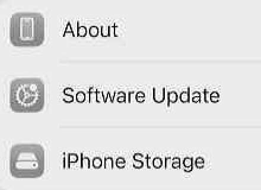 **Quality 30**, 21 KB. Blocky edges, halos around the text, still readable. | 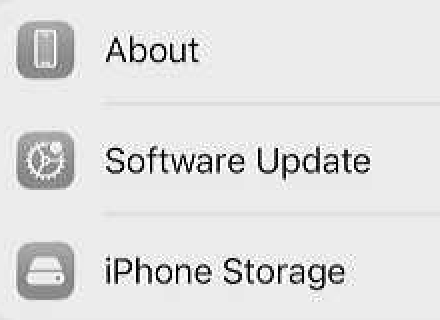 **Quality 50**, 26 KB. Clean enough to read; icons a little rough. |
|  **Quality 62**, 29 KB. Hard to tell from the default. | 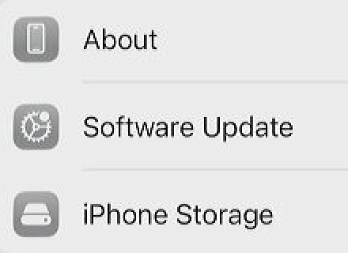 **Quality 80**, the default, 39 KB. |
| 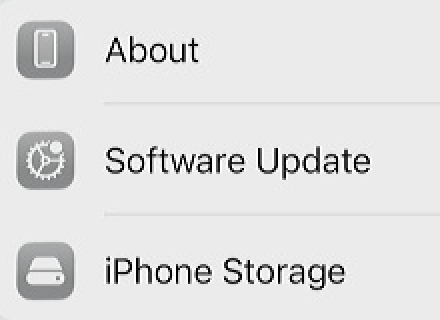 **Quality 94**, 61 KB. For pixel-level checks; no visible gain for reading. | |

For reading a screen, which is what an agent does with a screenshot, quality
50 to 80 is plenty, and a thousand screenshots at the default come to 39 MB:
less than six minutes of the default MJPEG stream. The encoder chip is not
involved; a screenshot is one JPEG encoded in software, a few milliseconds.

## Why the gap is so wide

- **MJPEG pays for every pixel, every frame.** A 64 KB photo thirty times a
  second is 15 Mbps whether or not anything on the screen moved. Lowering the
  quality or the frame rate helps in proportion: half the frames, half the
  data.
- **H.264 pays for change.** A still screen costs a keyframe every two seconds
  plus near-empty frames in between: about 0.3 Mbps, measured. Scrolling or
  video costs more, but never more than the cap, which the viewer's connection
  sets by itself between 0.3 and 4 Mbps. The Bitrate slider in the viewer's
  menu can hold it lower.
- **The rig works less too.** JPEG is compressed in software, by the rig's
  general-purpose processor. H.264 is compressed by a separate encoder chip
  the Pi 4 has for exactly this job.

## What the bitrate cap does

JPEG quality and the WebRTC bitrate cap are different kinds of knob. Quality
decides how many bytes *every* frame gets, moving or not. The cap decides the
most the H.264 stream may use, averaged over about a second, and the encoder
only spends that when something is moving.

| Cap | Most it can use per hour | What you see when things move | When it fits |
|---|---:|---|---|
| 300 kbps | 135 MB | Soft, smeary scrolling; text sharp again within 2 s of stopping | A tethered or metered connection |
| 800 kbps | 360 MB | Readable while scrolling, some blockiness on fast motion | Weak Wi-Fi, or a viewer far away |
| 1.5 Mbps | 675 MB | Clean scrolling, video content a little soft | The usual starting point |
| 4 Mbps | 1.8 GB | Everything crisp, including video apps | The same network, or a good home connection |

- **A still screen costs about the same at any cap**, about 0.3 Mbps: a
  keyframe every two seconds and almost nothing in between. The cap is a
  ceiling, not a rate. Only at 300 kbps are the keyframes themselves squeezed
  enough to soften the still picture a little; see the pictures below.
- **Left alone, the connection chooses.** The viewer's browser reports what
  arrives and when, and the rig moves its target between 0.3 and 4 Mbps
  accordingly. On the same network it climbs to 4 Mbps within seconds; on a
  struggling link it falls. Below 0.6 Mbps Roadie also halves the frame rate so
  that each frame keeps enough bytes to stay legible: at a 300 kbps cap the
  stream measured 15 frames a second, at 1.5 and 4 Mbps the full 30.
- **It does not change** the frame rate (30 a second, as captured), the
  picture's size, or the delay by more than a few milliseconds. A lower cap
  makes motion softer; once the screen settles, the next keyframe restores
  full sharpness.

## What the bitrate cap does to the picture

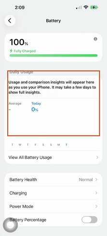

The Battery page of the phone's Settings, watched over WebRTC at two
different caps. The outlined band, a paragraph of text and two figures, is
shown below at its true size. It appears first with the page sitting still
and then at the same instant of the same animation, which is the Charging
page sliding in from the right after a tap on its row. A slide like that is
about as fast as a phone screen changes outside video. A third stream at the
4 Mbps cap looked the same as the 1.5 Mbps one in both states, so it is left
out of the pictures.

| 300 kbps | 1.5 Mbps |
|---|---|
| 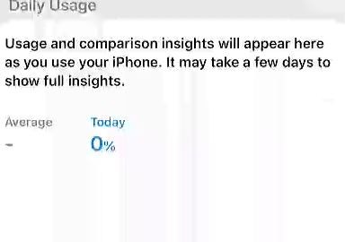 **Sitting still.** Readable, a little soft: keyframes of about 12 KB, 15 frames a second. | 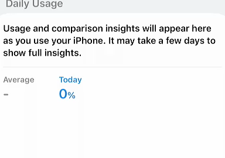 **Sitting still.** Sharp: keyframes of about 28 KB, 30 frames a second. |
| 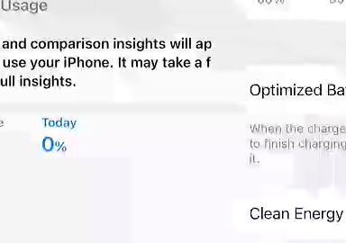 **Mid-slide.** The text smears into blocks until the page settles; 0.5 Mbps in that second. | 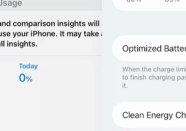 **Mid-slide.** Readable in flight; 1.3 Mbps in that second, the cap never reached. |

Two things to take from these. A 300 kbps cap is a real compromise: the still
page is a touch soft and anything moving turns to blocks, which is what a weak
link gets you. And above about 1.5 Mbps the cap rarely binds on a phone
screen: this slide used 1.3 Mbps in its busiest second under the 1.5 Mbps cap
and 2.1 under the 4 Mbps cap, with nothing to show for the difference, and a
video app is the only thing that would push it to 4.

## Portrait, landscape and the black bars

The capture device always delivers the full 1920×1080 frame, the shape of a
TV picture. In portrait the phone fills only a strip down the middle of it,
with black bars either side; in landscape it fills most of the frame. Roadie
crops the frame to the phone's picture before sending, so the black bars cost
nothing on either transport.

| Portrait | Landscape |
|---|---|
| 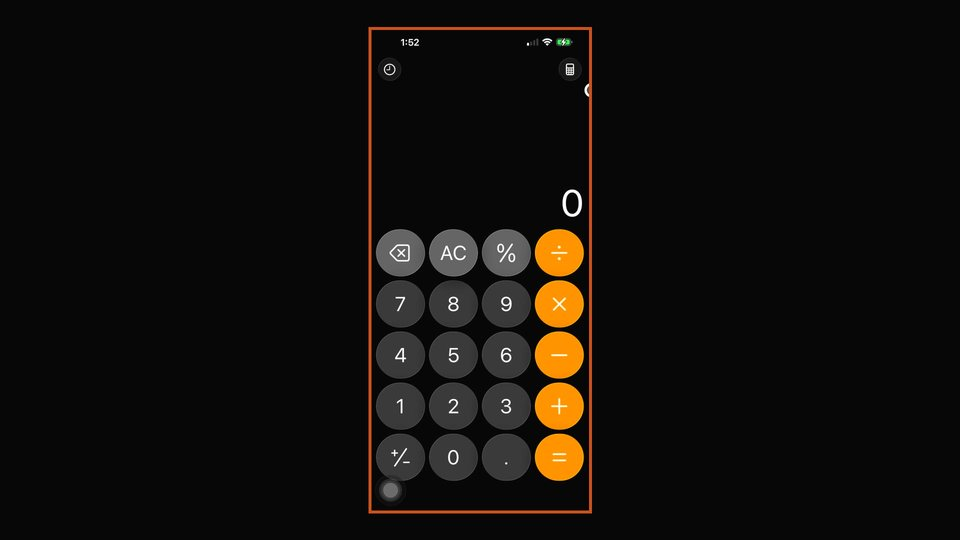 The whole frame as it arrives from the capture device, Calculator open, from Roadie's raw snapshot. The outline is the 446×972 picture Roadie keeps: 21% of the frame. | 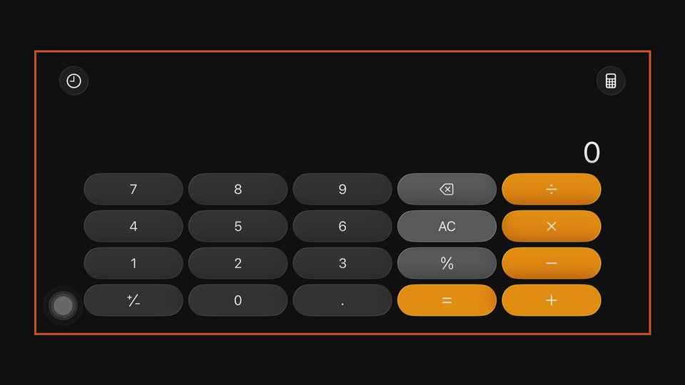 The same app after turning the screen through Roadie's rotate call. The picture is now 1728×798, 66% of the frame, with the bars above and below instead. |

Screenshots of the same app at quality 80 in each orientation, measured a
minute apart, are 38 KB in portrait and 64 KB in landscape. That is 1.7 times
the bytes for 3.2 times the pixels, because Calculator's landscape layout is
mostly black. A text-heavy screen such as Settings grows closer to the pixel
count, which is what the estimate in the table assumes.

| Picture | Pixels | Share of the frame | MJPEG frame at quality 80 | MJPEG at 30 fps |
|---|---:|---:|---:|---:|
| Portrait, 446×972 | 0.43 MP | 21% | 38 KB | 9.0 Mbps |
| Landscape, 1728×798 | 1.38 MP | 66% | 120 KB (est.) | 28.7 Mbps (est.) |
| Whole frame, 1920×1080 | 2.07 MP | 100% | 64 KB | 15.4 Mbps |

Landscape is not cheaper to send. It is a bigger picture, three times the
pixels, so MJPEG costs about three times as much. Less of the frame is thrown
away, but what is kept has to be sent. WebRTC barely notices: a still screen
costs about the same at either size, and only the moving case grows with the
picture, up to the cap. The whole uncropped frame costs less than the
landscape crop because its black bars compress to almost nothing in a JPEG,
which is also why cropping saves so much more in portrait than in landscape.

## What a JPEG frame weighs

Bytes per frame of the portrait picture at each quality, from one raw frame
of the calculator app, compressed by Roadie's own JPEG encoder. Quality 80 is
Roadie's default; the headline uses 94, the sharpest the viewer offers.

| Quality | 1080p portrait, 446×972 | 720p portrait, 298×648 | Whole 1080p frame | 1080p landscape (est.) |
|---:|---:|---:|---:|---:|
| 30 | 20 KB | 11 KB | 46 KB | 64 KB |
| 40 | 23 KB | 13 KB | 48 KB | 72 KB |
| 50 | 25 KB | 14 KB | 51 KB | 80 KB |
| 62 | 28 KB | 16 KB | 54 KB | 91 KB |
| 70 | 32 KB | 18 KB | 58 KB | 101 KB |
| 80 (default) | 38 KB | 22 KB | 64 KB | 120 KB |
| 90 | 51 KB | 30 KB | 80 KB | 162 KB |
| 94 | 64 KB | 37 KB | 89 KB | 204 KB |

The 720p picture (298×648) weighs more per pixel than the 1080p one because
the same detail is packed into fewer pixels. Quality values below 50 look
visibly blocky on text.

## What the rig does

| Case, 1080p capture at 30 fps | Roadie's share of one processor core |
|---|---:|
| Nobody watching | 9% |
| One WebRTC viewer | 20 to 26% |
| One MJPEG viewer, 720p at 10 fps | about 26% |
| One MJPEG viewer, 1080p at 30 fps | 92% |

The Pi 4 has four cores, so even the worst case leaves room, but a core almost
fully busy on JPEG is a core running hot and not available for anything else.
That software compression is the whole cost of MJPEG: the rig compresses each
frame once, however many people watch, so a second MJPEG viewer adds bandwidth
but not work. WebRTC compresses once too and sends the same stream to each
viewer. The browser's side also favours H.264: decoding it took 2 ms a frame
in Chromium, against building a new image from a JPEG thirty times a second.

## Delay

On the same network both arrive quickly. WebRTC measured about 90 to 100 ms
from the phone's glass to the browser's:

- 32 ms for the capture device to deliver a frame
- 5 ms to compress it
- 1 ms across the network
- 33 ms waiting in the browser's buffer so that playback stays smooth
- 2 ms to decode

MJPEG travels over an ordinary web connection, which never drops anything, so
on a congested or lossy link it queues up and the picture falls behind. WebRTC
drops late frames and stays current. That matters more away from home than on
the home network.

## What ends up in a recording

Vibium records a session with Firefox's WebDriver BiDi screencast: the Firefox
that Vibium drives records what it shows and writes a WebM file, a third
format that is neither of Roadie's two. When Vibium drives a phone with
recording on, that Firefox is showing Roadie's viewer page, so the recording
is a re-encoding of whatever the viewer displayed. Three things follow:

- **The recording can only be as sharp as the stream.** A viewer on WebRTC at
  a low cap records soft motion; one on MJPEG at quality 94 records sharp
  frames, with the rig at full stretch the whole time. From 1.5 Mbps up the
  still screen is sharp either way.
- **Recording keeps the stream running.** Vibium's Firefox stays on the viewer
  page for the whole session whether or not anyone looks at it, so the
  stream's cost applies for as long as the recording does: the "recording on"
  row above, not the agent-only row.
- **The file is written where Vibium runs**, a cloud box or a laptop, not on
  the rig. Firefox's encoder sets its size, not Roadie's settings. The network
  cost is the stream that fed it, which crosses from the rig to that machine
  the whole time.

For an agent reading a recording afterwards, sharp keyframes matter more than
smooth motion, which is the opposite of what a person watching live wants. A
recording made on the rig from the H.264 stream, or from screenshots taken
whenever the screen changes, would give that without a browser in the loop;
neither exists yet.

## How this was measured

- **The rig:** a Raspberry Pi 4 running Roadie, a UGREEN HDMI-to-USB capture
  device (model 15389), and an iPhone 15 Pro Max connected through a USB-C
  hub with an HDMI output, in portrait.
- **The whole frame:** Roadie's `/raw-snapshot`, which is the capture device's
  frame before cropping, with Calculator open in each orientation; the crop
  rectangles are the ones Roadie saved for this phone, from `/api/crop`. The
  two Calculator screenshots are `/snapshot?quality=80` in each orientation.
- **Screenshots:** fetched from the running Roadie with `/snapshot?quality=`
  at each quality, on the Settings screen shown; the sizes under the pictures
  are those files.
- **JPEG sizes:** one full frame saved from Roadie at quality 94 (1920×1080,
  88.5 KB), decoded and compressed again at each quality with the same JPEG
  encoder Roadie uses, for the portrait picture and for the same picture
  scaled to 720p. The landscape rows scale those bytes by pixel count, since
  the phone was in portrait.
- **WebRTC:** a test viewer with no screen (`rtcprobe`, in this repository)
  connected to the running Roadie for 20 s while the screen sat still and
  received 597 frames at 0.21 Mbps, including a keyframe every 2 s; the
  encoder reported 0.33 Mbps in its busiest second. The caps are targets the
  encoder does not exceed over time.
- **The cap pictures:** the headless viewer asked for each cap over the
  control channel and saved the H.264 stream while a held press opened the
  Battery page's Charging row. The frames were split out with ffmpeg and are
  shown at the phone picture's own size; in each run the still one is the
  frame taken a second before the slide and the moving one is the
  fastest-changing frame of it. Rates are the bytes of the stream in the
  second around that frame.
- **The viewer screenshot:** headless Chromium on the rig, signed in with the
  token, with the WebRTC picture playing.
- **CPU:** Roadie's own `/health` page and `top` on the rig, with Roadie
  reading the capture device directly and using the Pi's hardware H.264
  encoder.
- Data volumes are decimal (1 GB = 1000 MB) and count one viewer. Two viewers
  double the bandwidth on either transport.

The same page with a calculator for other settings is
[`mjpeg-vs-webrtc.html`](mjpeg-vs-webrtc.html) next to this file: open it in a
browser, or serve it from a static docs site. The numbers here are the same
ones.
