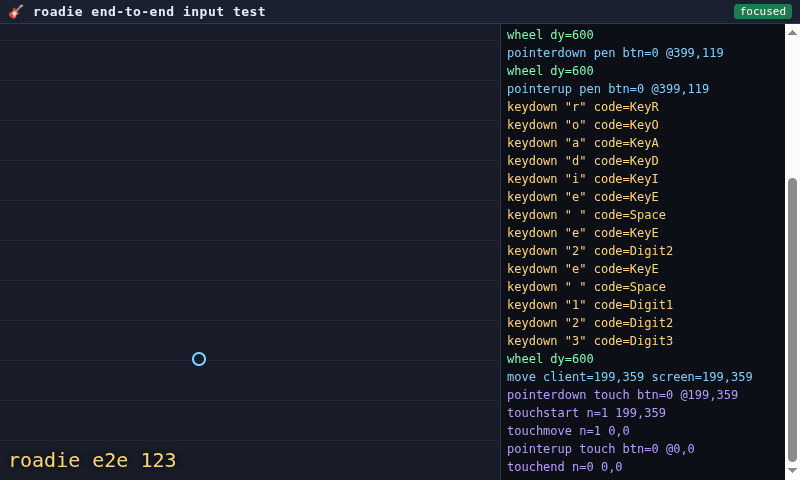

# How to Test the Boards

Three commands. Each checks input that was *actually received*, not just that
the boards accepted a command.

| Command | Checks |
|---------|--------|
| `make test-hid` | keyboard, mouse, click, scroll, touch — read back from `/dev/input` |
| `make test-e2e-pi` | the same, driven through roadie's HTTP API into a real browser |
| `make test-audio` | voice input: a tone through the relay, out the HID board's USB mic |

Run `make setup` once first. The HID board must be plugged into this machine,
so the input it injects comes back here.

None of them need a monitor: `make test-hid` uses no display at all, and
`make test-e2e-pi` creates its own.

## What the browser test actually does



That is the page at the end of a run. The cyan ring is where the pointer was
left, and `roadie e2e 123` is text that arrived as real keystrokes. The log
on the right is every event the page received, oldest first — you can read
the typed string straight down it, a `keydown` per character, then the touch:
`pointerdown`, `touchstart` at `199,359`, `touchend`.

The pointer events say `pen` because Chromium classifies the board's
absolute-positioning device as a stylus rather than a mouse.

`make test-e2e-pi` stands up two small servers and a browser:

- **roadie** — reuses one already serving on `:8080` if there is one, otherwise
  starts its own on a free port. This is what the test drives, via
  `POST /api/hid/type`, `/api/hid/mouse/move` and friends.
- **the harness** — a throwaway HTTP server on `127.0.0.1`, random port. It
  serves the test page and receives what the page reports back. The page is
  **not** served by roadie; it lives in `board/e2e/page.html`.

It then opens your desktop's default browser in kiosk mode, sized to the
screen. The browser is whatever `xdg-settings get default-web-browser` says —
chromium on a stock Raspberry Pi OS, and Firefox is handled too. It runs with
a throwaway profile, so your own browser session and tabs are untouched.

A run prints all of it:

```
✅ Collector listening on http://127.0.0.1:40523/
✅ roadie is serving at http://127.0.0.1:39871
✅ Desktop default browser is chromium (chromium.desktop)
✅ Page ready: screen 800x480, viewport 799x388, dpr 1
```

Each check sends input through roadie and compares what the page received:

```
✅ mouse move (32767,32767): page saw screen (799, 479), expected (799, 479)
✅ keyboard: page assembled 'roadie e2e 123'
✅ mouse scroll: page saw wheel dy=600
✅ touch: page saw touchstart at screen (199, 359), expected (200, 359)
```

Coordinates are compared in **screen pixels**, so HID's 0–32767 range is
checked against the real display geometry rather than taken on trust.

### Seeing the page yourself

The harness's server only lives for the duration of a run, so its URL dies
with it. Two ways to look at the page:

```bash
# leave the browser open after the checks finish
python3 board/test_e2e.py --target pi --keep-open

# or just open the page on its own
chromium board/e2e/page.html
```

Opened on its own it still works as a live input monitor: it has no external
dependencies, and its attempts to report back fail harmlessly. So you can
point the HID board at this machine, open the page, and watch keystrokes,
pointer moves and touches arrive — a cursor ring, a touch blob, the typed
text, and a running event log.

## Watching the tests

`make test-e2e-pi` runs on this machine's desktop and **takes over the screen**
while it runs, so if you already have a VNC or screen-sharing session open,
you just watch it there. Nothing extra to set up.

The test's input follows focus, so don't use that desktop mid-run. For an
unattended or CI run, where something stealing focus would break the test,
keep off the desktop entirely:

```bash
ROADIE_E2E_ISOLATED=1 make test-e2e-pi
```

Worth watching: the page draws what it receives, so you can see *why* a check
failed rather than just that it did.

### On a Pi with no monitor

There is no desktop to take over, so the test makes its own display and you
see nothing. To watch one, run a display you can connect to:

```bash
make set-vnc-password     # once
make start-vnc-server     # prints an address; connect a viewer and leave it
make test-e2e-pi          # appears in that viewer
make vnc-status
make stop-vnc-server
```

The port is always 5934, so save the address and password in your viewer once.
It is view-only — a stray click would steal focus and break a run.

## Testing a phone instead

Move the HID board to the phone, leave the relay here, and the test page runs
on the phone:

```bash
make test-e2e-android    # opens the page over ADB
make test-e2e-iphone     # prints a URL to open in Safari
make test-e2e-pc         # prints a URL for another computer
```

Android needs ADB over WiFi, because the phone's USB port is busy hosting the
HID board:

```bash
adb tcpip 5555           # once, with the phone on USB
adb connect <phone-ip>:5555
```

## Useful flags

```bash
make test-hid-quick                      # skip the slower checks
python3 board/test_hid.py --dump         # print every input event
python3 board/test_hid.py --skip touch   # skip a check
python3 board/test_e2e.py --target pi --keep-open   # leave the browser up
ROADIE_E2E_RESOLUTION=1920x1080 make test-e2e-pi    # bigger virtual screen
```

## When something fails

| Symptom | Fix |
|---------|-----|
| `Relay data port not found` | relay unplugged, or needs a re-plug after flashing |
| `Could not open any HID input device` | run `make setup`, then log out and back in |
| multi-touch reported as skipped | expected: roadie's udev rule makes this host single-touch |
| every check fails | check the TX/RX/GND jumpers between the boards |
| `make test-audio` finds no signal | the HID board needs a physical re-plug after flashing |
| viewer shows black | the run finished and tore the display down |

For board-level problems see [Troubleshooting](troubleshooting.md), and
[REPL Tutorial](../tutorials/repl.md) to talk to a board directly.
